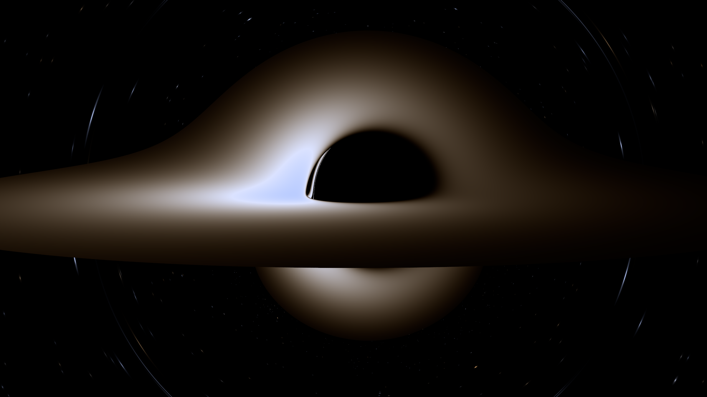
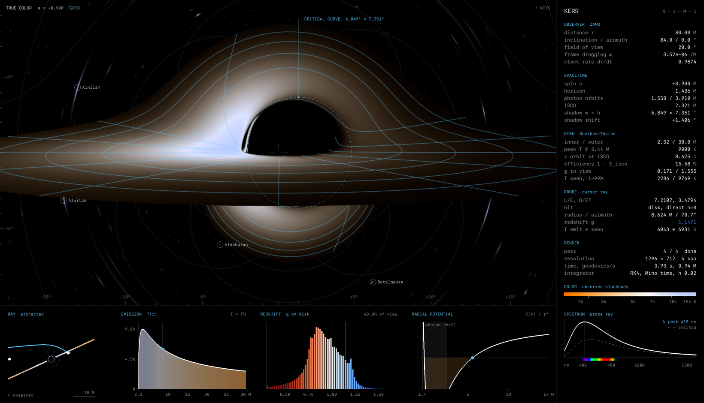
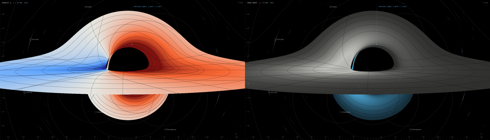
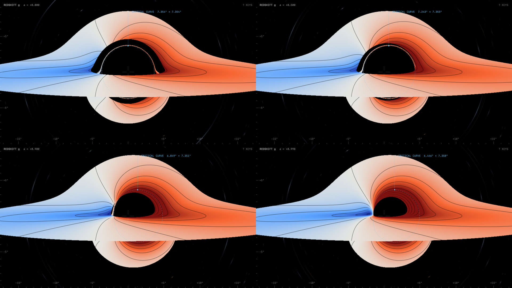
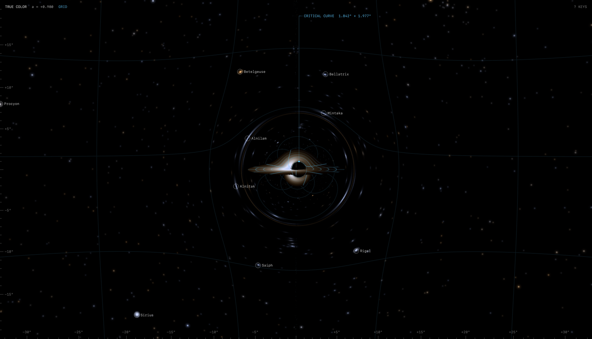

# kerr

A physically based renderer for spinning (Kerr) black holes, written in C.



Each pixel traces a light ray backward from the camera through Kerr spacetime. The ray either falls into the hole, hits a thin accretion disk, or escapes to a sky built from a real star catalog. Disk colors come from blackbody emission shifted by gravitational redshift and Doppler motion, so the colors and brightness are computed rather than painted. A test suite checks the integrator against closed-form results from the literature.

- Null geodesics for any spin up to |a| = 0.998, integrated from Carter's separated equations in Mino time
- Novikov-Thorne thin disk with the Page-Thorne flux profile, ISCO and efficiency for the chosen spin
- Observed color from Planck spectra shifted by g = ν<sub>obs</sub>/ν<sub>emit</sub>, through CIE color matching to sRGB
- The real sky: 9,096 stars from the Yale Bright Star Catalog at J2000 positions, magnitudes and colors
- An interactive viewer with progressive refinement and a probe that traces and plots the ray under the cursor
- 17 checks against analytic results, run with `make check`
- The still renderer needs only libc, libm and pthreads; the viewer adds SDL2

## Build

```sh
brew install sdl2   # only needed for the viewer
make                # builds ./blackhole and ./live
make check          # runs the physics checks
```

The still renderer is plain C11 with POSIX threads (tested on macOS). The viewer uses SDL2 for the window and CoreText for text, so it currently builds on macOS only.

## Still renderer

```sh
./blackhole                          # writes blackhole.png, 1920×1080 at 9 samples per pixel
./blackhole --spin 0.998 --incl 75   # near-extremal spin, steeper view
./blackhole --dist 300 --fov 40      # back off until Orion shows around the Einstein ring
```

| Option | Default | |
|---|---|---|
| `--spin A` | 0.9 | spin a/M, from -0.998 to 0.998; negative means the disk orbits against the spin |
| `--dist R` | 80 | camera distance in M |
| `--incl DEG` | 84 | angle between the spin axis and the line of sight |
| `--azim DEG` | 0 | camera rotation around the spin axis |
| `--fov DEG` | 20 | vertical field of view |
| `--temp K` | 9000 | peak disk temperature |
| `--rout R` | 30 | disk outer radius in M |
| `--size WxH`, `--ss N` | 1920x1080, 3 | image size, N×N samples per pixel |
| `--exposure X` | 1 | exposure multiplier |

## Viewer



`./live` opens the viewer. While the camera moves it renders a quarter-resolution preview; when it stops it refines in four passes up to full resolution at 4 samples per pixel. The panel reports the observer, the spacetime (horizon, photon orbits, ISCO, shadow size and shift), the disk, and the ray under the cursor. The plots show that ray's path, the disk temperature profile, the redshift distribution in view, the ray's radial potential R(r), and the emitted and observed spectrum at the probed point.

| Key | | Key | |
|---|---|---|---|
| drag | orbit | scroll | distance |
| arrows | orbit in 5° steps | `,` `.` | spin |
| `1` `2` `3` | true color, redshift, image order | `g` | coordinate grid and star names |
| `[` `]` | disk temperature | `-` `=` | field of view |
| `o` | Orion view | space | automatic orbit |
| `s` | save PNG | `h` | hide panels |
| `r` | reset | `?` | key list |

The grid draws lensed coordinate lines: radius and azimuth on the disk, right ascension and declination on the sky. The dashed outline is the shadow edge for the current camera, found numerically by bisecting between captured and escaping rays.



Redshift mode colors the disk by g, with contours every 0.1. Image-order mode separates the direct image of the disk, the secondary image formed by light that passes under the hole, and the photon ring.

## Spin



Spin 0, 0.5, 0.9 and 0.998, left to right and top to bottom. As spin grows the ISCO moves in from 6 M to 1.24 M, the inner disk orbits faster, and the shadow flattens on the side where the disk approaches. At 0.998 the disk reaches so close to the horizon that it covers most of the region inside the critical curve, the inner shadow described by Chael et al. (2021).

## The sky



The sky is aligned so that Orion sits behind the hole in the default view, with north up. From 80 M the Einstein ring, about √(4M/r) = 12.8° in radius, is wider than the frame, so every star in the close-up is a demagnified secondary image of the sky around it. From 300 M (press `o`) the ring shrinks to 6.6° and the constellation appears around it. Betelgeuse and Rigel are pushed outward, and the belt stars nearest the line of sight smear into arcs along the ring.

## How it works

The full derivation is in [docs/physics.md](docs/physics.md).

Carter's constant separates the null geodesic equations. In Mino time the radial and polar motions become independent second-order equations with polynomial right-hand sides, which pass turning points without sign bookkeeping. The radial equation is written in u = 1/r. In r, the far-field motion is a tiny difference of r⁴-sized terms, and RK4 round-off was enough to turn rays around at the wrong radius. At a = 0 the u equation reduces to Binet's u″ + u = 3Mu².

The camera is a zero-angular-momentum observer, and each pixel direction in its local frame fixes the ray's constants of motion L/E and Q/E². The disk is optically thick and emits as a local blackbody with the Novikov-Thorne temperature profile. Since I<sub>ν</sub>/ν³ is invariant along a ray, a blackbody at temperature T seen with frequency ratio g looks exactly like a blackbody at gT. That spectrum is integrated against the CIE 1931 color matching functions and converted to sRGB, and an asinh stretch (Lupton et al. 2004) maps the high dynamic range to the screen without shifting hues.

## Validation

`make check` compares the integrator with results that have closed forms:

| Check | Expected | Relative error |
|---|---|---|
| Schwarzschild critical impact parameter | 3√3 M | 7e-11 |
| Light bending at b = 100 M | series through (M/b)⁵, Keeton & Petters (2005) | 1e-7 |
| Shadow edges, a = 0.5 and 0.9 (equatorial observer) | photon orbit L/E, Bardeen (1973) | 8e-11 |
| Image positions of a lensed star at 10⁵ M | lens equation through (M/b)³ | 1e-5 |
| ISCO formula vs minimum of circular-orbit energy | Bardeen et al. (1972) | 1e-6 |
| Conserved quantity drift on a ray circling the photon shell | 0 | 2e-11 |
| Radiative efficiency, a = 0 | 1 - √(8/9) | 2e-15 |
| Disk flux peak, a = 0 | 9.55 M | 1e-4 |
| Orion orientation, sky alignment, 6504 K white point | | pass |

## Performance

On an Apple M4 (10 cores), the default 1920×1080 still at 9 samples per pixel takes 37 s, about 0.5 million geodesics per second. In the viewer a preview frame takes about 25 ms, and refining to full resolution at 4 samples per pixel takes about 5 s.

## Layout

```
src/physics.h       spacetime, geodesics, disk, sky, camera, color, tone mapping
src/blackhole.c     still renderer and the check suite
src/live.c          interactive viewer
src/png.h           PNG writer
src/bsc5.h          star catalog (generated)
tools/bsc5_to_h.c   converts the CDS catalog into src/bsc5.h; run with make catalog
```

## References

- Carter, B. (1968). Global structure of the Kerr family of gravitational fields. *Phys. Rev.* 174, 1559.
- Bardeen, J. M., Press, W. H., Teukolsky, S. A. (1972). Rotating black holes: locally nonrotating frames, energy extraction, and scalar synchrotron radiation. *ApJ* 178, 347.
- Bardeen, J. M. (1973). Timelike and null geodesics in the Kerr metric. In *Black Holes* (Les Houches).
- Novikov, I. D., Thorne, K. S. (1973). Astrophysics of black holes. In *Black Holes* (Les Houches).
- Page, D. N., Thorne, K. S. (1974). Disk-accretion onto a black hole. *ApJ* 191, 499.
- Mino, Y. (2003). Perturbative approach to an orbit evolving around a Kerr black hole. *Phys. Rev. D* 67, 084027.
- Keeton, C. R., Petters, A. O. (2005). Formalism for testing theories of gravity using lensing by compact objects. *Phys. Rev. D* 72, 104006.
- Lupton, R. et al. (2004). Preparing red-green-blue images from CCD data. *PASP* 116, 133.
- Wyman, C., Sloan, P.-P., Shirley, P. (2013). Simple analytic approximations to the CIE XYZ color matching functions. *JCGT* 2(2).
- Ballesteros, F. J. (2012). New insights into black bodies. *EPL* 97, 34008.
- Hoffleit, D., Warren, W. H. (1991). The Bright Star Catalogue, 5th revised edition. CDS V/50.
- Chael, A., Johnson, M. D., Lupsasca, A. (2021). Observing the inner shadow of a black hole. *ApJ* 918, 6.

## License

MIT
